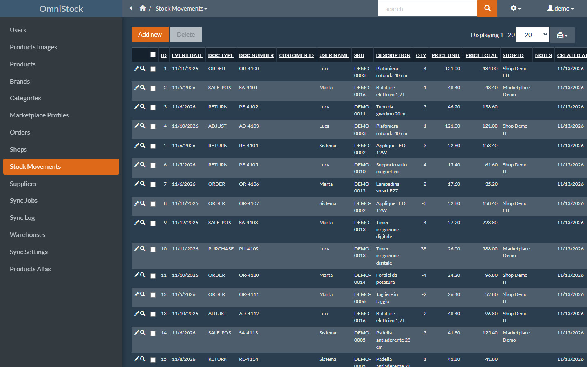
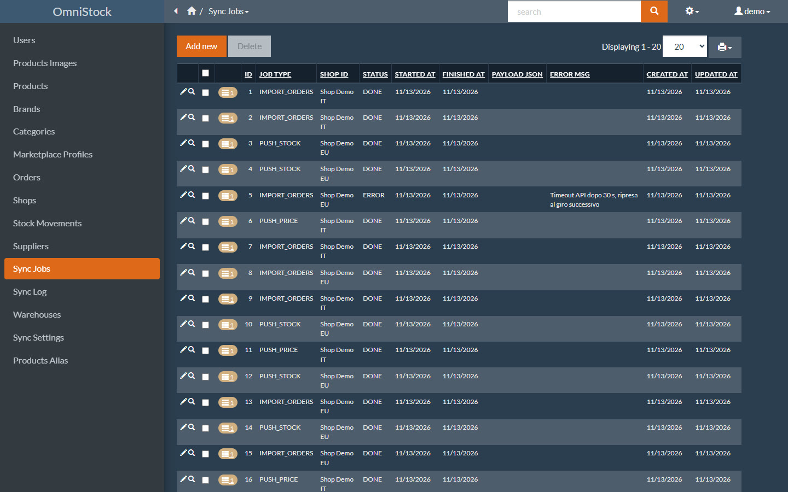
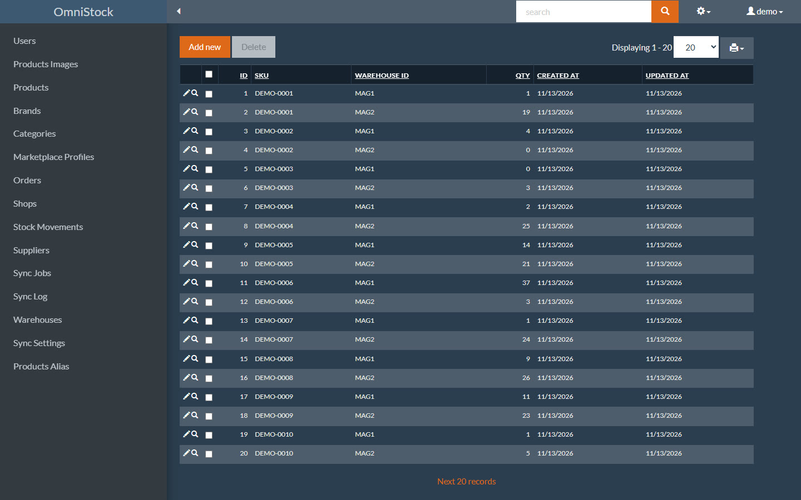

# OmniStock

Gestionale di **magazzino e catalogo multicanale**: un'unica anagrafica prodotti e un'unica giacenza da cui alimentare più negozi online, con sincronizzazione verso PrestaShop tramite API.

Prototipo progettato e sviluppato da me (novembre 2025).

**Stack:** PHP · MySQL · PHPRunner · JavaScript · PrestaShop Webservice API

| Job di sincronizzazione | Giacenze per magazzino |
|---|---|
|  |  |

Screenshot da un'installazione locale con dati di prova.

## Cosa gestisce
- **Catalogo:** prodotti con alias SKU, marchi, categorie, immagini, fornitori.
- **Prezzi:** listini multipli e prezzo per prodotto e listino.
- **Magazzino:** più magazzini, livelli di giacenza e movimenti di carico/scarico.
- **Canali di vendita:** negozi e profili marketplace, con l'associazione prodotto–negozio.
- **Ordini:** ordini e righe ordine, con aggregati di vendita giornalieri per i report.
- **Sincronizzazione:** coda di job, impostazioni e log per ogni sincronizzazione; endpoint per creare, aggiornare, cancellare e importare prodotti su PrestaShop e servire le immagini.

21 tabelle, eventi personalizzati per ognuna e una piccola API interna (`api/`).

## Codice
L'applicazione completa è nell'archivio `OmniStock_20-11-25.zip` (output di PHPRunner più il codice personalizzato in `usercode/` e `api/`). La connessione al database punta a un'installazione locale di sviluppo.

---
**Filippo Bonanno** · sviluppatore web (PHP, PrestaShop, Laravel, JavaScript)
